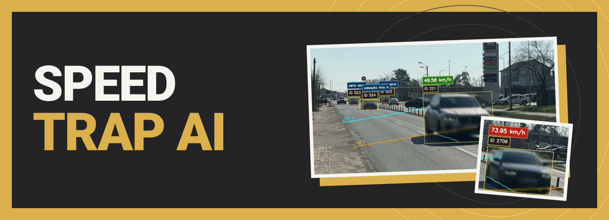
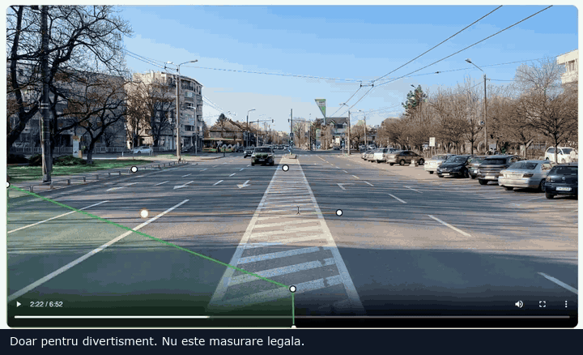
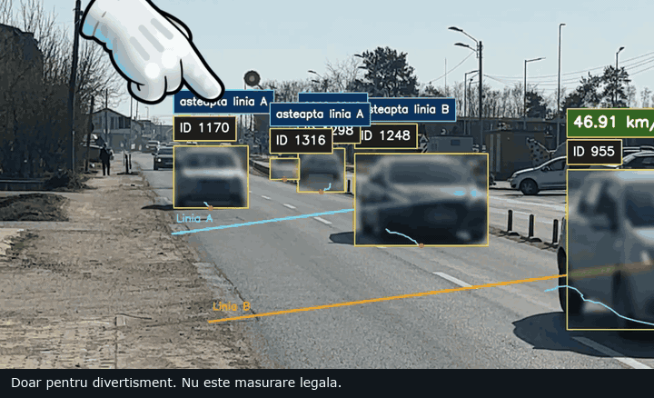
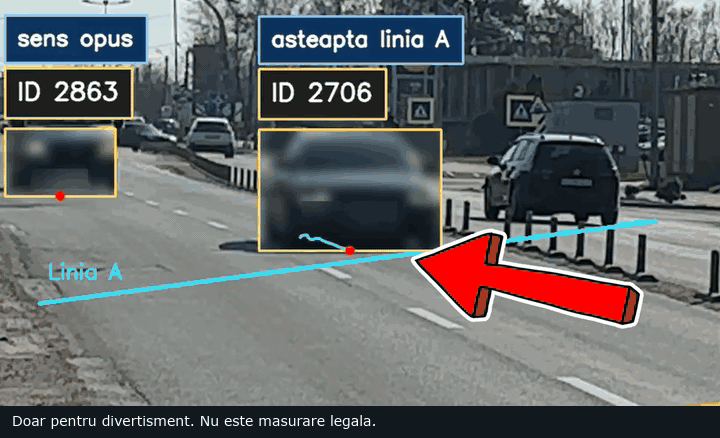
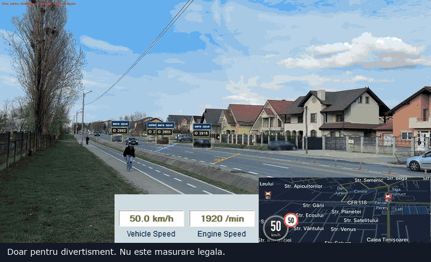
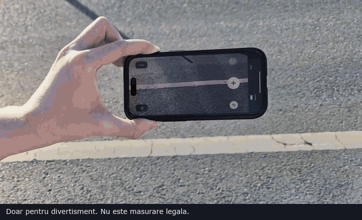
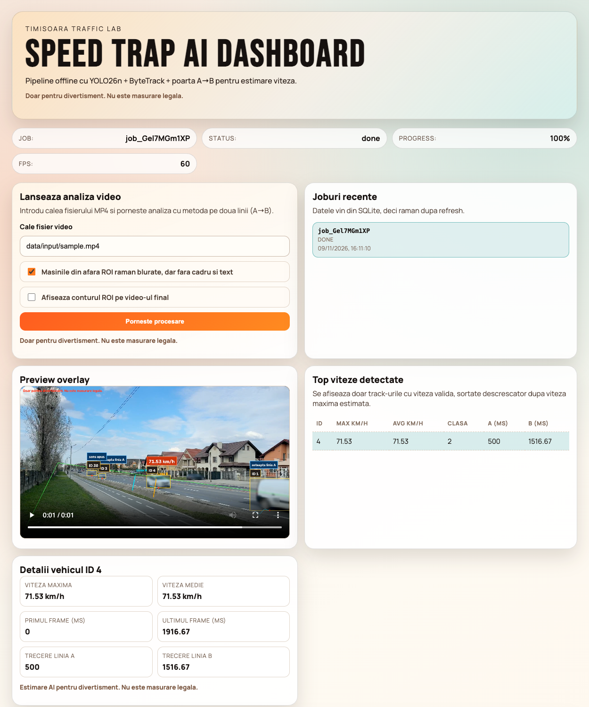
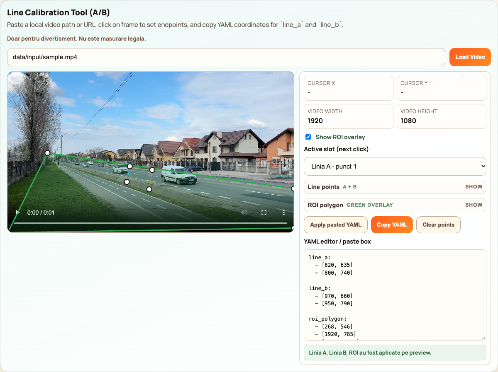
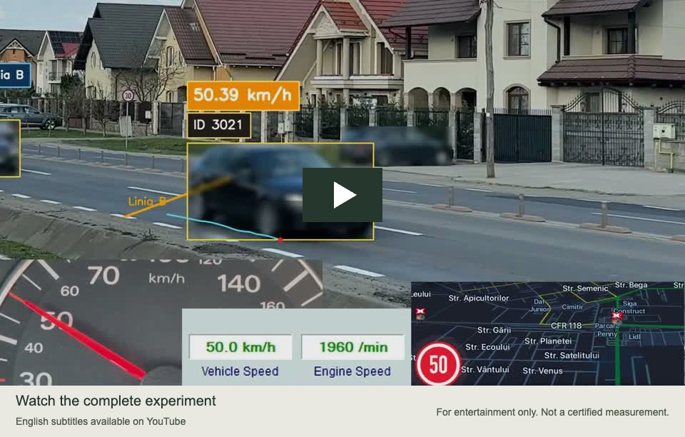

# Speed Trap AI



I built this for a video filmed in Timișoara. It uses **YOLO26 and ByteTrack** to follow cars and estimate their speed from the time they take to travel between two lines. The dashboard lets you place the lines and review the processed recording.

> **Doar pentru divertisment. Nu este masurare legala.**
>
> For entertainment and education only. This is an estimated speed, not a certified measurement or legal evidence.

## See how it works

### 1. Draw the lines and choose the road area



Pause the recording and place **Linia A (line A)** and **Linia B (line B)** across the carriageway. Drag endpoints to refine them, then outline the road with the green **region of interest (ROI)**. Enter the real distance traveled between the lines in meters; the image alone cannot tell you that distance.

The GIF comes from the original film. The current dashboard lets you click endpoints, move whole lines or the ROI, fine-tune coordinates, and copy or paste calibration YAML.

### 2. Follow the same car with ByteTrack



**YOLO detects the vehicles. ByteTrack associates their detections across frames.** The hand in the film makes that association visible: follow one car and its ID as it moves through the scene. The hand is an editorial annotation in the video; the engine renders boxes, IDs, trails, and a red anchor point.

### 3. Start at A. Stop at B. Calculate the speed.



The red dot is the vehicle's **bottom-center anchor**. Crossing A starts the timer; crossing B stops it. Only the same tracked ID crossing both gates in the configured direction produces a final speed.

```text
Vehicle crosses Linia A (line A) at t1
Vehicle crosses Linia B (line B) at t2

speed_kmh = distance_meters / (t2 - t1) * 3.6
```

For example, **20 meters in 1.5 seconds = 48 km/h**. Timing comes from the video frame index and its FPS, so analysis can run slower than playback without changing the formula.

This is one average estimate over the gate distance. The dashboard's “max” and “average” columns summarize that cached gate result; they do not measure continuous instantaneous speed.

### 4. Compare the result with the car



The final experiment in the film puts the AI result beside **vehicle sensor data, the speedometer, and Waze/GPS**. The overlay shows **50.39 km/h** while the other displayed readings are around 50 km/h.

This is an illustrative comparison from that recording, not a measured error bound or a validation study. Camera movement, distance calibration, FPS, reflections, occlusion, and tracker ID changes can all affect the result.

## Cool tricks from the video

### Measure the road with a phone

I used the iPhone's **Measure** app to estimate the length of a painted road dash and the gap between dashes. I also compared the app with a tape measure on a smaller object, which you can see in the film.



On that stretch of road, I got roughly **2.8 m for a white dash** and **5.9 m for the gap**. Those are measurements from that location, not standard sizes to assume on every road. Measure gives an estimate, so any error in that distance carries through to the speed calculation.

### Use the markings as a ruler

Once I knew those two lengths, I could count the markings between the virtual gates. For a span covering three complete dashes and the two gaps between them:

```text
3 × 2.8 m + 2 × 5.9 m = 20.2 m
```

That explains where a distance such as **20.2 m** can come from. Place line A and line B at the ends of the span you counted. If a gate falls partway through a dash or gap, include only that part. The distance is measured along the road, not across the image in pixels.

### Keep the camera in the same place

I used a tripod to keep the shot steady. The gates are attached to image coordinates, so moving or zooming the camera after calibration changes where they sit on the road. Set up the shot first, then draw the gates.

### Check the red dot when a result looks wrong

The red dot shows the exact anchor used for timing. In the film, one unusually high result comes with a visible jump in that point. Following the dot frame by frame is a useful way to investigate a surprising number before trusting it.

## The dashboard



Start a job, inspect its annotated video, and click a leaderboard row to jump to that vehicle's crossing. Job history survives refresh through SQLite. Each job exports an **H.264 overlay, CSV summary, JSONL events, and JSON metadata**.

This screenshot uses the supplied 1.93-second traffic clip and a real engine run. The demo configuration uses an **unmeasured example distance of 20.2 m**: the displayed speed illustrates the workflow, not the car's verified speed.



## Run it locally

### Requirements

- **Node.js 22.13+** and **pnpm 10**; the repository pins pnpm 10.15.0.
- **Python 3.11 or 3.12** recommended for PyTorch wheel compatibility.
- **FFmpeg** on `PATH` for browser-playable H.264 output.
- Internet for dependency installation and the first model download. A GPU is optional.

### Install

Clone or download this repository, open its folder, and run:

```bash
pnpm install --frozen-lockfile
python3.11 -m venv engine/python/.venv
engine/python/.venv/bin/python -m pip install --upgrade pip
engine/python/.venv/bin/python -m pip install -r engine/python/requirements.txt
```

Use `python3` instead of `python3.11` if it already selects a supported version. On Windows, create the environment with `py -3.11 -m venv engine/python/.venv` and use `engine/python/.venv/Scripts/python.exe` for pip commands. The API finds either environment automatically.

Put your recording at **`data/input/sample.mp4`**. Source videos and YOLO weights stay local; they are intentionally absent from a fresh clone. Ultralytics downloads `yolo26n.pt` when first needed and the engine tries `yolo11n.pt` if loading the primary model fails.

### Calibrate your scene

1. Run `pnpm dev` and open the dashboard at [localhost:5173](http://localhost:5173).
2. In **Line Calibration Tool**, load `data/input/sample.mp4` and pause on a useful frame.
3. Click the two endpoints of A, then the two endpoints of B. Add four ROI vertices if needed.
4. Drag shapes or edit coordinates, then choose **Copy YAML**.
5. Paste `line_a`, `line_b`, and `roi_polygon` into [`camera.default.yaml`](engine/python/configs/camera.default.yaml). Set `distance_meters` to the measured road distance and `direction` to the intended movement.
6. Start processing with the same repository-relative video path.

**Copying YAML does not save it to the backend.** Save the configuration file yourself and create a new job after changes. The default coordinates are an example for a **3840 × 2160** scene; they must be replaced for another camera or resolution. Changing pixel resolution also changes the required coordinates.

The default direction `[0, 1]` accepts downward motion; `[1, 0]` accepts rightward motion. Configure A before B along that path. To inspect the reverse flow, recalibrate the gates and direction and run another job.

### Start the app

```bash
pnpm dev
```

- Dashboard: [http://localhost:5173](http://localhost:5173)
- API health: [http://localhost:8787/health](http://localhost:8787/health)

The API resolves video paths relative to the repository and accepts existing video files inside it. Use `data/input/your-video.mp4`; no machine-specific absolute path is needed.

To select another scene on macOS/Linux:

```bash
SPEED_TRAP_CAMERA_CONFIG=engine/python/configs/my-camera.yaml pnpm dev
```

PowerShell equivalent: `$env:SPEED_TRAP_CAMERA_CONFIG="engine/python/configs/my-camera.yaml"`, then `pnpm dev`.

### Process a file without the dashboard

```bash
./scripts/run-offline.sh data/input/sample.mp4
# Optional second argument selects another camera configuration:
./scripts/run-offline.sh data/input/sample.mp4 engine/python/configs/my-camera.yaml
```

Or run Python directly, including on Windows:

```bash
# Run from the repository root. Use .venv/Scripts/python.exe on Windows.
engine/python/.venv/bin/python engine/python/run_pipeline.py \
  --input data/input/sample.mp4 \
  --config engine/python/configs/camera.default.yaml \
  --out data/output/manual-demo
```

Terminal-only runs write files without inserting a dashboard history entry. Dashboard jobs use the API, which also indexes their results in SQLite.

## Configuration and outputs

| Setting | Meaning |
| --- | --- |
| `line_a`, `line_b` | Two `[x, y]` endpoints per gate, in original video pixels |
| `distance_meters` | Measured distance along the vehicle's path between gates |
| `direction` | Expected motion vector in image coordinates |
| `roi_polygon` | Road polygon for accepted speed events; `[]` allows the full frame |
| `anchor_point` | `bottom_center` by default; `center` available for experiments |
| `privacy_blur` | `true` by default; blurs detected vehicle boxes |
| `device` | `auto`, `cpu`, or `mps`; auto also selects CUDA when available |
| `min_crossing_delta_ms` | Debounce interval for crossing events; default 150 ms |

ROI filters speed events and displayed tracks. YOLO still detects the full frame so vehicles outside the ROI can also be blurred.

```text
data/output/<jobId>/
├── overlay.mp4      # Annotated, silent video
├── summary.csv      # Per-track crossing times and gate speed
├── events.jsonl     # Frame-by-frame track events
└── metadata.json    # FPS, model/device, configuration, output information
```

The default database is `data/speed-trap.sqlite`. None of these runtime files belong in Git.

Optional environment variables:

| Variable | Default / use |
| --- | --- |
| `PORT` / `HOST` | API: `8787` / `127.0.0.1` |
| `SPEED_TRAP_PYTHON_BIN` | Override the automatically detected Python environment |
| `SPEED_TRAP_CAMERA_CONFIG` | Repository-relative or absolute camera YAML path |
| `SPEED_TRAP_DB_PATH` | `data/speed-trap.sqlite`; use another path for an isolated demo |
| `VITE_API_BASE_URL` | `http://localhost:8787/api` |
| `VITE_ARTIFACT_BASE_URL` | `http://localhost:8787/artifacts` |

Vite variables may be placed in `apps/dashboard/.env.local`; see [the example](apps/dashboard/.env.example). API variables are shell environment variables, not automatically loaded from `.env` files.

## Project structure

```text
apps/dashboard/      React + Vite + TypeScript UI
apps/api/            Express API, Python job runner, Node built-in SQLite
engine/python/       YOLO detection, ByteTrack, speed gate, privacy, exports
scripts/             Local runners and reproducible README GIF export
docs/                Guides and public demo assets
```

The main dashboard at `/` runs real recorded-file analysis. `/radar` is a local preview and visual calibration demo; `/presentation` is a simulated multi-camera presentation. Those presentation screens do not implement live network ingest.

## Build and checks

```bash
pnpm build
pnpm build:radar
cd engine/python
.venv/bin/python -m unittest discover -s tests -v
```

The GitHub workflow builds both frontend variants and the API, then checks the speed formula and rejection cases without downloading model weights. A full video run additionally needs the Python requirements, FFmpeg, a model, and your recording.

After `pnpm build`, `pnpm --filter @speed-trap/api start` runs the compiled API. `pnpm --filter @speed-trap/dashboard preview` serves the built UI locally. Static hosting such as Netlify serves the frontend only; processing still needs the Node API and Python engine. The API is a local development tool without authentication or a public-service job queue.

## Limitations and troubleshooting

- **No final speed:** the car may not cross both gates, may move in the opposite direction, fall outside the ROI, or receive a new tracker ID. A visible box is not enough.
- **Wrong or implausible speed:** check the road distance, original pixel dimensions, gate order, direction, camera stability, and the red anchor. Crossing times are frame-quantized; the debounce interval may reject very short crossings.
- **Preview does not play:** check `ffmpeg -version` and rerun the job. The engine keeps a raw MP4 fallback if transcoding fails, but not all browsers play it.
- **Python cannot start:** install requirements into `engine/python/.venv`, or set `SPEED_TRAP_PYTHON_BIN` explicitly.
- **Model download fails:** check internet access and the installed Ultralytics version, or pre-download the named weights into `engine/python/`.
- **Privacy:** default vehicle blur is a best-effort aid. Missed detections, faces, and other identifying details can remain; inspect any footage you share.

Processing is offline-first: no phone streaming backend, homography, per-lane calibration, continuous instantaneous speed, or certified accuracy validation. Use a fixed camera and a measured distance for meaningful experiments.

## More detail

- [Romanian technical guide](docs/ghid-viteza-ai-ro.md)
- [Video production notes](docs/video-production-playbook-ro.md)
- [Media cuts and reproduction](docs/assets/README.md)
- [Local demo reproduction](docs/demo.md)

This project uses [Ultralytics YOLO](https://github.com/ultralytics/ultralytics) and ByteTrack. Review [Ultralytics' AGPL-3.0 / Enterprise licensing](https://www.ultralytics.com/license) before redistributing or integrating the engine. Film and media rights are separate from code licensing.

## Watch the full experiment

[](https://www.youtube.com/watch?v=CDCUi20Q6CM)

[Watch the full experiment on YouTube](https://www.youtube.com/watch?v=CDCUi20Q6CM)

Romanian audio. **English subtitles available** — enable captions in the YouTube player.
