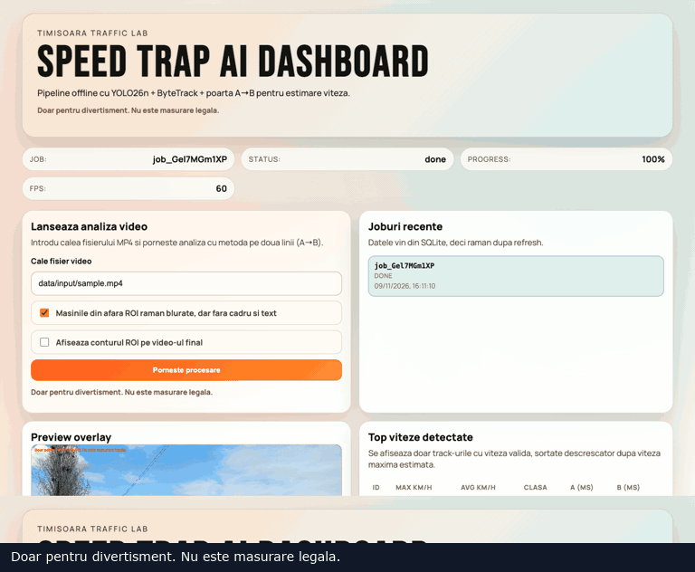

# Reproduce the local dashboard demo

> Doar pentru divertisment. Nu este masurare legala.

The README dashboard was captured from a real run of the supplied short traffic recording: 1.93 seconds, originally 3840×2160 at 60 fps. Its source is deliberately not committed. Use your own fixed-camera footage and recalibrate it; the included demo coordinates only fit that particular shot.

## Prepare the clip

After installing the dependencies in the main README, convert your local source to a browser-friendly format. This command removes audio and container metadata, changes resolution, and preserves frame timing:

```bash
ffmpeg -i /path/to/your/traffic.mov \
  -map 0:v:0 -map_metadata -1 -an -vf scale=1920:1080 \
  -c:v libx264 -crf 20 -pix_fmt yuv420p -movflags +faststart \
  data/input/sample.mp4
```

Do not stretch, loop, slow, or accelerate footage used for speed estimation. Converting resolution requires matching coordinates; altering timestamps changes the result.

## Use a separate demo database

On macOS/Linux, from the repository root:

```bash
SPEED_TRAP_DB_PATH=data/demo.sqlite \
SPEED_TRAP_CAMERA_CONFIG=engine/python/configs/camera.demo.yaml \
pnpm dev
```

The demo YAML uses an **unmeasured example distance of 20.2 m**. With the supplied converted clip, the recorded run produced a valid crossing for track 4 at A = 500 ms and B = 1516.67 ms, yielding 71.53 km/h. This demonstrates the formula and application workflow; it does **not** establish that vehicle's speed. Measure the scene distance to interpret a result.

1. Open the dashboard and load `data/input/sample.mp4` in calibration.
2. Paste the demo YAML and press **Apply pasted YAML** to inspect the geometry.
3. Set the same file path in the processing panel, enable the ROI outline if desired, and start processing.
4. Wait for `done`, then click a leaderboard row to seek the annotated video.
5. Inspect the vehicle details and generated files in `data/output/<jobId>/`.

The screenshot uses genuine engine output and real interface interactions. The initial default 4K calibration produced no complete crossings on this short 1080p clip; adapting the geometry to the scene is essential.

For a terminal-only run:

```bash
./scripts/run-offline.sh data/input/sample.mp4 engine/python/configs/camera.demo.yaml
```

## Visual tour



The tour shows actual clicks and scrolling in the running dashboard. The four explanatory film GIFs are separate excerpts; their exact source intervals and the FFmpeg reproduction command are listed in [media notes](assets/README.md).
